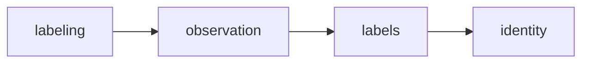

# 현재 구조

이 페이지는 [ARCHITECTURE.md](../../ARCHITECTURE.md)와 [src/mosemo/AGENTS.md](../../src/mosemo/AGENTS.md)를 요약한다. 두 문서와 다르면 원본이 맞다. 구조의 근거 결정은 [ADR 0011](../../docs/adr/0011-split-bounded-contexts-logically-with-layered-packages.md)과 이를 부분 대체한 [ADR 0015](../../docs/adr/0015-group-entrypoints-and-platform-packages.md)다.

## 한눈에 보기

애플리케이션 코드는 `src/mosemo/` 아래 일곱 개 최상위 패키지로 나뉜다.

| 패키지 | 종류 | 책임 |
| --- | --- | --- |
| `identity` | BC | 계정, 로그인·토큰, 계정에 등록된 앱 설치(Device) |
| `labels` | BC | 계정의 라벨 목록, 가입 시 기본 라벨 |
| `observation` | BC | 활동 레코드, 관찰 타임라인 투영과 조회, 집중 세션 |
| `labeling` | BC | 라벨 확정·정정, AI 라벨 제안과 제안 job, 라벨 타임라인 |
| `shared` | 공용 커널 | 둘 이상의 BC가 쓰고 업무 의미가 없는 것(domain·application·presentation) |
| `platform` | 실행 기반 | 로깅·시계·provider·스케줄링, `database/`(설정·엔진·매핑·트랜잭션), `messaging/`(Kafka 어댑터) |
| `entrypoints` | 조립 루트 | 프로세스마다 하나: `api/`(FastAPI), `consumer/`(활동 배치 Consumer), `batch/`(배치 job) |

프로세스·DB·Postgres 스키마는 하나다. BC 분리는 논리 분리(ADR 0011의 L1)이며, BC 사이 외래키와 한 트랜잭션 안의 BC 간 호출은 허용된다.

## BC 사이 의존 방향

- 왼쪽 BC만 오른쪽 BC를 import한다(건너뛴 import 허용). 상류 BC가 하류의 변경을 알아야 하면 import하지 않고 도메인 이벤트로 알린다([ADR 0012](../../docs/adr/0012-notify-cross-context-changes-with-in-process-domain-events.md)).
- 다른 BC 코드는 그 BC의 `public.py`로만 쓴다. 다른 BC의 테이블은 조회·조인하지 않고, 여러 BC 데이터가 필요하면 애플리케이션에서 조립한다.
- ADR 0011은 `analytics` BC를 추가 예정으로 두며, 추가되면 `labeling` 위에 놓인다(`pyproject.toml`의 주석).

## BC 내부 구조

BC 루트에는 세 파일만 둔다.

- `public.py`: 다른 BC와 조립 루트가 쓰는 공개 입구
- `bootstrap.py`: 조립 루트와 Alembic 전용. 테이블 매핑 함수(`map_tables`)와 BC 객체 그래프를 제공한다
- `__init__.py`: docstring만 허용

나머지 코드는 계층 폴더 네 개에 둔다. 의존 방향은 presentation → application → infrastructure → domain이며, presentation은 infrastructure를 직접 import하지 않는다.

| 역할(위치) | 요약 |
| --- | --- |
| router(`presentation`) | HTTP 입출력만 바꾸고 UseCase의 `execute`만 호출한다. 공개 오류는 BC 오류 코드의 `ApiException`으로 바꾼다 |
| Mapper(`presentation`) | 요청 스키마와 엔티티·입출력 값 사이의 상태 없는 변환 |
| UseCase(`application`) | 유스케이스 하나에 클래스 하나, 공개 메서드는 `async def execute`만. 쓰기는 `unit_of_work`, 읽기는 `read_snapshot`으로 트랜잭션을 연다 |
| 공개 협력자(`application`) | 다른 BC의 UseCase가 자기 트랜잭션 안에서 부르는 입구. 첫 인자로 `db_session`을 받고 트랜잭션을 열지 않는다 |
| Repository(`infrastructure`) | aggregate root 하나를 통째로 불러오고 저장한다. 판단과 트랜잭션은 하지 않는다 |
| Query(`infrastructure`) | 읽기 모델을 읽고 데이터를 바꾸지 않는다 |
| 엔티티(`domain`) | dataclass aggregate와 값 객체. SQLAlchemy·FastAPI·Pydantic을 import하지 않는다 |

자세한 규칙은 [src/mosemo/AGENTS.md](../../src/mosemo/AGENTS.md) 「역할 규칙」을 본다. 영속화 방식은 [영속성·메시징·배치 실행](persistence-and-messaging.md)에서 다룬다.

## 조립 루트와 설정

`entrypoints/{api,consumer,batch}`는 BC의 `bootstrap.py`·`public.py`만 import해서 객체 그래프를 만든다. 예를 들어 API 프로세스는 [src/mosemo/entrypoints/api/contexts.py](../../src/mosemo/entrypoints/api/contexts.py)에서 네 BC의 테이블을 매핑하고 `Identity` → `Labels` → `Observation` → `Labeling` 순서로 하류 BC의 공개 객체(`account_directory`, `label_catalog`, `observation_timeline` 등)를 상류 BC 생성자에 넘긴다. 라우터는 [src/mosemo/entrypoints/api/routes.py](../../src/mosemo/entrypoints/api/routes.py)에서 `/api/v1` 아래에 묶인다.

설정은 ADR 0015 「설정 소유 규칙」을 따른다. 각 진입점의 `config.py`가 자기 프로세스의 환경 변수만 읽고, BC는 설정 모듈(`platform.database.config`, `platform.messaging.config`)을 import하지 않는다. 필요한 값은 BC `bootstrap.py`가 정의한 순수 타입(예: identity의 `IdentityConfig`)으로 조립 루트가 넘긴다.

## 강제 방법

규칙은 문서만이 아니라 도구로 강제된다.

- `poe lint-imports`: `pyproject.toml`의 `[tool.importlinter]` 계약. BC 사이 `layers` 계약, BC마다 계층·외부 import 제한 계약, `shared`·`platform`이 BC와 진입점을 import하지 않는 계약, BC → `mosemo.entrypoints` 금지 계약, `apscheduler`는 `platform.scheduling`만·`faststream`·`aiokafka`는 `platform`만 import하는 계약이 있다.
- `.codex/skills/verification/scripts/validate_architecture.py`, `validate_conventions.py`와 `tests/unit/harness/`가 나머지 구조 규칙을 검사한다.
- Ruff `TID251`이 `DeclarativeBase`·`mapped_column` 재도입을 막는다.

새 BC를 추가하면 BC 계약, BC 사이 `layers` 계약의 자리, `bounded contexts do not import entrypoints` 계약의 `source_modules`를 함께 추가해야 한다([AGENTS.md](../../AGENTS.md) 「빌드와 검증」).

## 관련 페이지

- [영속성·메시징·배치 실행](persistence-and-messaging.md)
- [유효한 결정](../decisions/active-decisions.md)
