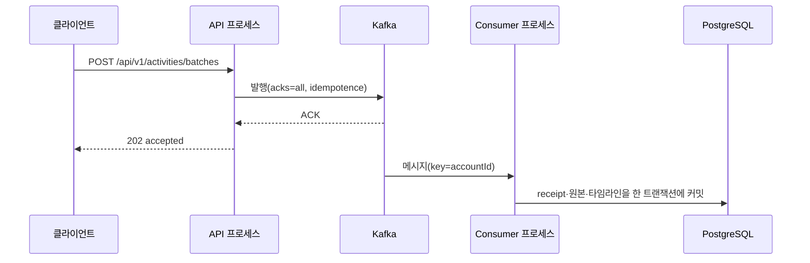

# 영속성·메시징·배치 실행

이 페이지는 데이터가 어떻게 저장되고, 활동 배치가 어떻게 전달·처리되며, 주기 작업이 어떻게 실행되는지를 정리한다. 패키지 경계는 [현재 구조](current-structure.md)를, 결정 목록은 [유효한 결정](../decisions/active-decisions.md)을 본다. 원본과 다르면 원본(ADR·코드)이 맞다.

## 도메인 모델과 매핑

근거: [ADR 0013](../../docs/adr/0013-persist-dataclass-aggregates-with-imperative-mapping.md)

- 엔티티는 BC `domain`의 `@dataclass(eq=False, repr=False, kw_only=True)` aggregate다. 값 객체·공개 읽기 모델·이벤트는 `@dataclass(frozen=True)`다.
- 기반 클래스는 `shared`의 `AggregateRoot`(이벤트 목록)와 `DomainEvent`뿐이다.
- `Table`과 imperative mapping은 BC `infrastructure`에 둔다. 각 BC `bootstrap.py`의 `map_tables()`가 `platform.database.persistence`의 `MetaData`(`ORM_METADATA`)에 테이블을 등록한다. `DeclarativeBase`·`mapped_column`은 Ruff `TID251`로 금지된다.
- 엔티티 자신의 식별자는 `id`, 다른 엔티티 참조는 `{엔티티}_id`로 짓는다.

## 트랜잭션과 도메인 이벤트

근거: [src/mosemo/platform/database/transactions.py](../../src/mosemo/platform/database/transactions.py), [ADR 0012](../../docs/adr/0012-notify-cross-context-changes-with-in-process-domain-events.md)

트랜잭션은 UseCase만 연다. Repository·Query·공개 협력자는 첫 인자로 받은 `db_session`을 쓰고 트랜잭션을 열지 않는다.

| 헬퍼 | 동작 |
| --- | --- |
| `unit_of_work(db_session, dispatcher)` | 쓰기 트랜잭션을 연다. 본문이 끝나면 flush하고, 추적 중인 aggregate의 이벤트와 `record_event`로 기록한 이벤트를 남은 것이 없을 때까지 dispatch한 뒤 커밋한다 |
| `read_snapshot(db_session)` | `SET TRANSACTION READ ONLY` 트랜잭션을 열고 이벤트를 dispatch하지 않는다 |
| `reset_session(db_session)` | 한 세션에서 여러 트랜잭션을 돌 때 로드된 객체와 추적 root를 비운다 |

- 두 헬퍼 모두 이미 열린 트랜잭션이 있으면 `TransactionAlreadyOpenError`를 낸다.
- `EventDispatcher`는 현재 `BEFORE_COMMIT` 단계만 지원한다. handler는 같은 세션·트랜잭션에서 실행되므로 handler가 실패하면 원래 변경도 롤백된다.
- 상류 BC가 하류 BC의 변경을 알아야 할 때 import 대신 이 이벤트를 쓴다. 예를 들어 API 조립 루트는 `labels_bootstrap.register_handlers(get_event_dispatcher())`로 labels의 handler를 등록한다.

## 마이그레이션

- Alembic 환경 [migrations/env.py](../../migrations/env.py)는 네 BC의 `map_tables()`만 호출해 `ORM_METADATA`를 채운다. 테이블 정의를 따로 import하지 않는다.
- 리비전은 `migrations/versions/`에 날짜 접두어 파일로 쌓인다. 이미 적용된 마이그레이션은 다시 쓰지 않고, 스키마 변경에는 새 마이그레이션을 추가한다([AGENTS.md](../../AGENTS.md) 「변경 원칙」).
- 로컬 적용은 `poe migration-dev`(`alembic upgrade head`)다.

## 활동 배치 전달(Kafka)

근거: [ADR 0006](../../docs/adr/0006-deliver-activity-batches-through-kafka.md), [ADR 0007](../../docs/adr/0007-store-batch-receipts-with-activity-transactions.md), [ADR 0008](../../docs/adr/0008-order-observations-and-transition-existing-timelines.md)

- API의 `POST /api/v1/activities/batches`는 인증·입력·Device 귀속 확인 뒤 배치를 Kafka에 발행하고, 발행 ACK를 받으면 `202`를 돌려준다. DB 처리나 Consumer offset commit을 기다리지 않는다. 발행할 수 없거나 ACK가 늦으면 `503`과 `Retry-After: 1`을 돌려주고, 클라이언트는 같은 `batchId`·내용으로 재시도한다.
- Publisher는 `acks="all"`, `enable_idempotence=True`로 만든 `KafkaBroker`를 쓴다([src/mosemo/platform/messaging/runtime.py](../../src/mosemo/platform/messaging/runtime.py)). 메시지 key는 계정 ID라서 같은 계정은 같은 partition으로 모인다.
- 기본 토픽은 `activities.registration-requested`, Consumer group은 `mosemo.activity-batches`다([src/mosemo/platform/messaging/config.py](../../src/mosemo/platform/messaging/config.py)).
- Consumer 진입점(`poe batch-consumer`, [src/mosemo/entrypoints/consumer/activity_batches.py](../../src/mosemo/entrypoints/consumer/activity_batches.py))은 `BATCH_ENABLED=true`가 아니면 시작하지 않는다. 메시지마다 새 세션을 열어 observation의 배치 처리 UseCase를 부른다.
- 배치 처리는 receipt claim, 원본별 채택·거절, 원본 저장, 관찰 타임라인 갱신, 처리 결과 저장을 하나의 DB 트랜잭션에서 수행한다. receipt의 식별 범위는 `(accountId, deviceId, batchId)`다(ADR 0007).
- 원본 순서는 같은 Device 안에서는 `sequence`, 여러 Device 사이에서는 `(observedAt, deviceId, sequence, eventId)` 오름차순으로 병합한다(ADR 0008).

## 관찰 타임라인 projection

근거: [ADR 0004](../../docs/adr/0004-project-observation-timeline-on-write.md)

- 활동 원본은 보존하고, 관찰 활동 구간과 수집 공백은 쓰기 시 `activity_timeline_segments` 테이블에 projection한다. 조회는 projection을 다시 계산하지 않는다.
- 늦게 도착한 원본도 받아들이며, 영향받는 구간부터 다시 재생해 기존 구간과 수렴할 때까지만 범위를 넓힌다.
- 날짜 경계는 계정의 IANA 시간대로 계산한다.
- ADR 0004의 쓰기 경계 일부는 ADR 0007이, 원본 순서·이력 전환 일부는 ADR 0008이 부분 대체했다. 대체 관계는 [유효한 결정](../decisions/active-decisions.md)에 정리되어 있다.

## 배치 job(APScheduler)

근거: [ADR 0010](../../docs/adr/0010-run-batch-jobs-in-apscheduler-process.md)(실행 경로는 [ADR 0011](../../docs/adr/0011-split-bounded-contexts-logically-with-layered-packages.md)이 부분 대체), [src/mosemo/platform/scheduling.py](../../src/mosemo/platform/scheduling.py), [src/mosemo/entrypoints/batch/registry.py](../../src/mosemo/entrypoints/batch/registry.py)

- 활동 배치(Kafka)와 구분하려고 이 구조는 "batch job"으로 부른다.
- 모든 job은 `entrypoints/batch/registry.py`의 `build_jobs`에 등록하고 이름이 유일해야 한다. 현재 등록된 job은 labeling의 라벨 제안 job 하나다.
- 실행 방식은 두 가지다: `poe batch-jobs serve`(스케줄 있는 job을 주기 실행하는 상시 프로세스)와 `poe batch-jobs run JOB_NAME`(한 번 실행하고 결과를 exit 코드로 알림).
- 스케줄러는 UTC `AsyncIOScheduler`이며 모든 job에 `max_instances=1`, `coalesce=True`, `misfire_grace_time=None`을 적용한다. 종료할 때는 실행 중 job을 취소하고 최대 10초 기다린다.
- 상시 프로세스는 단일 인스턴스를 가정하며 분산 잠금이 없다.

## 관련 페이지

- [현재 구조](current-structure.md)
- [유효한 결정](../decisions/active-decisions.md)
