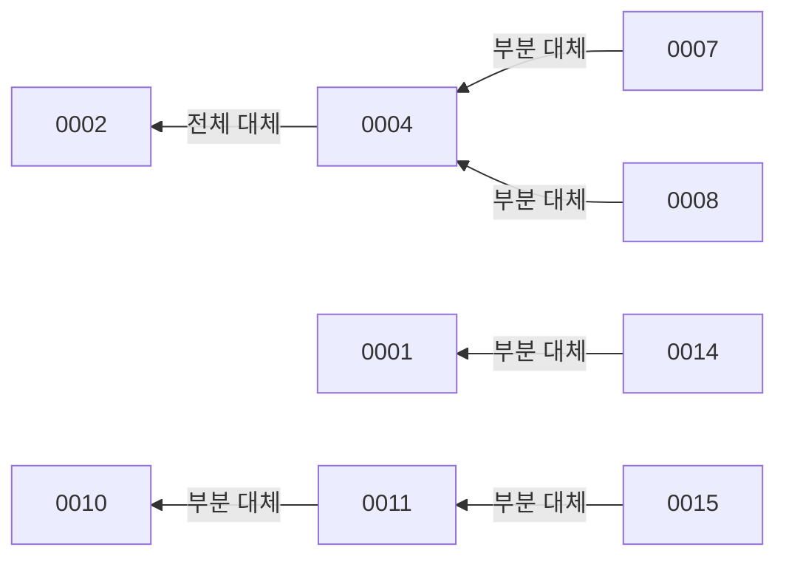

# 유효한 결정

유효 여부는 각 ADR 앞부분의 `status`로 판단한다. `status: accepted`만 유효 목록에 넣고, `status: superseded`는 목록에서 빼고 `superseded_by`가 가리키는 ADR로 안내한다. 본문의 "부분 대체" 표기는 대체한 ADR과 함께 보여 준다. 이 페이지와 ADR 원문이 다르면 원문이 맞다. ADR 작성 절차는 [architecture-decision Skill](../../.codex/skills/architecture-decision/SKILL.md)을 따른다.

## 유효한 ADR 목록

| ADR | 결정 요지 | 대체 관계 |
| --- | --- | --- |
| [0001](../../docs/adr/0001-public-api-error-boundary.md) | 공개 API 오류 경계를 명시적으로 닫는다. 공통 `ErrorResponse`와 `error.status` 분기, 런타임 응답과 OpenAPI 문서 레지스트리 분리, validation detail 규칙 | 일부를 0014가 부분 대체 |
| [0003](../../docs/adr/0003-devices-own-device-identity.md) | `Device`·`deviceId`를 공통 용어로 쓰고 Device 등록 API는 `POST /api/v1/devices`다 | 패키지 위치는 이후 0011로 identity BC에 속한다 |
| [0004](../../docs/adr/0004-project-observation-timeline-on-write.md) | 활동 원본은 유지하고 관찰 타임라인은 쓰기 시 `activity_timeline_segments`로 projection한다 | 0002를 대체. 일부를 0007·0008이 부분 대체 |
| [0005](../../docs/adr/0005-separate-observation-and-personal-label-confirmation.md) | 관찰 사실과 개인 라벨 확정을 분리한다. AI는 제안만 하고 사용자의 최신 확정값만 집계에 반영한다 | 없음 |
| [0006](../../docs/adr/0006-deliver-activity-batches-through-kafka.md) | 활동 배치는 독립 Kafka 브로커로 전달하고 발행 ACK 후 `202`로 수락한다 | 없음 |
| [0007](../../docs/adr/0007-store-batch-receipts-with-activity-transactions.md) | 배치 처리 receipt를 원본·타임라인과 같은 DB 트랜잭션에 저장한다 | 0004의 쓰기 경계를 부분 대체 |
| [0008](../../docs/adr/0008-order-observations-and-transition-existing-timelines.md) | Device별 관찰 순번(`sequence`)과 결정적 병합으로 원본 순서를 정하고 기존 이력을 전환한다 | 0004의 원본 순서·이력 전환을 부분 대체 |
| [0009](../../docs/adr/0009-define-public-json-timestamps-and-responses.md) | 공개 JSON은 camelCase, 시각은 UTC `Z` 문자열, 성공 응답은 공통 envelope 없이 도메인 데이터를 직접 반환한다 | 없음 |
| [0010](../../docs/adr/0010-run-batch-jobs-in-apscheduler-process.md) | 배치 job 정의와 실행 방식을 분리하고 APScheduler 단일 프로세스에서 주기 실행한다 | 패키지 위치·실행 경로를 0011이 부분 대체 |
| [0011](../../docs/adr/0011-split-bounded-contexts-logically-with-layered-packages.md) | Bounded Context를 논리 분리하고 BC마다 계층 패키지를 둔다. BC 사이 의존 방향과 `public.py` 규칙 | 0010을 부분 대체. 일부를 0015가 부분 대체 |
| [0012](../../docs/adr/0012-notify-cross-context-changes-with-in-process-domain-events.md) | BC 간 변경은 프로세스 내 도메인 이벤트로 알리고 커밋 직전 같은 트랜잭션에서 처리한다 | 없음 |
| [0013](../../docs/adr/0013-persist-dataclass-aggregates-with-imperative-mapping.md) | dataclass aggregate와 imperative mapping으로 영속화하고, 쓰기는 UseCase·Repository, 읽기는 Query로 나눈다 | 없음 |
| [0014](../../docs/adr/0014-align-public-identifiers-and-error-codes-with-contexts.md) | 오류 코드는 BC가 소유하고 공개 식별자·오류 코드 이름을 BC 경계에 맞춘다 | 0001을 부분 대체 |
| [0015](../../docs/adr/0015-group-entrypoints-and-platform-packages.md) | 진입점을 `entrypoints`로 묶고 기술 기반을 `platform`으로 재구성하며 설정 소유 규칙을 정한다 | 0011을 부분 대체 |

## 대체된 결정

| 대체된 ADR | 상태 | 대신 볼 ADR |
| --- | --- | --- |
| [0002](../../docs/adr/0002-activity-record-storage-and-read-time-timeline.md) 활동 원본 단건 저장·조회 시 타임라인 계산 | `status: superseded`, `superseded_by: ADR-0004` | [0004](../../docs/adr/0004-project-observation-timeline-on-write.md) |

ADR 0002는 유효 목록에 넣지 않는다. 원문은 당시 판단의 근거로 보존되어 있다.

## 부분 대체 관계

부분 대체는 대체된 ADR이 여전히 `status: accepted`로 남아 있고, 바뀐 조항만 새 ADR을 따른다는 뜻이다. 아래 관계에서는 두 ADR을 함께 읽는다.

- **[0004](../../docs/adr/0004-project-observation-timeline-on-write.md) ← [0007](../../docs/adr/0007-store-batch-receipts-with-activity-transactions.md)**: 0004의 쓰기 경계 중 Kafka 경로의 DB 쓰기를 receipt와 함께 Handler에서 수행하고, 계정 advisory lock을 legacy 경로에만 적용하도록 바꾼다. 읽기 모델 구조, 날짜 경계, Device 출처 비노출 등 나머지는 0004를 유지한다.
- **[0004](../../docs/adr/0004-project-observation-timeline-on-write.md) ← [0008](../../docs/adr/0008-order-observations-and-transition-existing-timelines.md)**: `receivedAt` 동률 정렬을 Device별 관찰 순서와 결정적 병합으로 바꾸고, Device별 `sequence`를 관찰 순서에도 쓴다. 원본·projection 원자성, 계정 잠금, 날짜 경계는 0004를 유지한다.
- **[0001](../../docs/adr/0001-public-api-error-boundary.md) ← [0014](../../docs/adr/0014-align-public-identifiers-and-error-codes-with-contexts.md)**: 단일 `ErrorCode` Enum 대신 BC별 오류 코드 enum과 `CommonErrorCode`(공통 기반 `ApiErrorCode`)가 오류를 소유하고, BC별 `ERROR_DOCS`를 조립 루트가 합친다. 런타임과 OpenAPI 분리, 헤더의 전송 문맥 소유, 공통 오류 구조, validation detail 규칙은 0001을 유지한다.
- **[0010](../../docs/adr/0010-run-batch-jobs-in-apscheduler-process.md) ← [0011](../../docs/adr/0011-split-bounded-contexts-logically-with-layered-packages.md)**: `mosemo/batch_jobs` 패키지와 `python -m mosemo.batch_jobs` 실행 경로를 스케줄링 기반 모듈, `batch` 조립 루트, 각 BC `bootstrap.py`로 바꾼다. job 정의와 실행 방식 분리, 단일 프로세스, 겹침 방지·misfire 정책은 0010을 유지한다.
- **[0011](../../docs/adr/0011-split-bounded-contexts-logically-with-layered-packages.md) ← [0015](../../docs/adr/0015-group-entrypoints-and-platform-packages.md)**: `infra/`, `api/`, `consumer/`, `batch/`의 위치와 이름을 `platform/`, `entrypoints/{api,consumer,batch}/`로 바꾸고, BC → `mosemo.entrypoints` 금지 계약을 더한다. BC 구성, Context Map, BC 내부 계층은 0011을 유지한다. 그래서 0011 본문의 `infra.scheduling`은 지금 `platform.scheduling`이다.

## 관련 페이지

- [현재 구조](../architecture/current-structure.md): ADR 0011·0015가 정한 패키지 구조
- [영속성·메시징·배치 실행](../architecture/persistence-and-messaging.md): ADR 0004·0006·0007·0008·0010·0012·0013의 현재 구현
