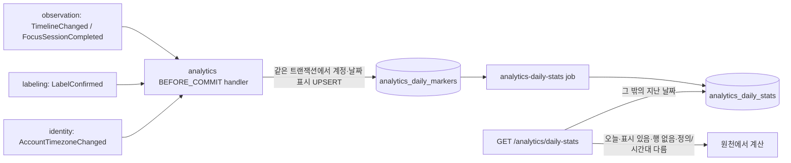

# 활동 분석

활동 분석은 관찰 타임라인(사실)·확정 라벨(사용자가 정한 의미)·집중 세션(사용자가 의도한 작업)을 합쳐, 하루 동안 어디에 시간을 썼고 얼마나 자주 오갔으며 집중 세션에서 무엇이 이탈을 만들었는지 보여 주는 기능이다. 세 원천의 권위는 바꾸지 않고, AI 추정이나 미관찰 시간의 추정은 결과에 넣지 않는다.

**현재 상태**: 요구사항·지표 명세는 `status: draft`, 설계 ADR 0016은 `status: proposed`다. 그래도 `analytics` BC에는 조회 API 두 개, 다시 계산 표시 handler, 일간 통계 테이블과 배치 job이 구현되어 있다. 90일 지난 원천의 S3 이관과 동결(`frozen_before`)은 아직 코드에 없다. 원본 문서·코드와 이 페이지가 다르면 원본이 맞다.

## 분석 데이터 C1~C7

원본: [docs/requirements/activity-analytics.md](../../docs/requirements/activity-analytics.md) 「현재 구현 범위」

| ID | 분석 데이터 | 단위 |
| --- | --- | --- |
| C1 | 앱 사용 시간 순위와 사용 대상(앱·사이트) 사용 시간 순위 | 계정 시간대의 날짜 |
| C2 | 날짜별 사용 대상 전환 횟수와 목록 | 계정 시간대의 날짜 |
| C3 | 세션별 사용 대상 전환 횟수와 목록 | 완료된 집중 세션 |
| C4 | 세션 분석 시간의 집중·이탈·확정 미분류·판정 대기·불투명·미관찰 구성 | 완료된 집중 세션 |
| C5 | 방해 앱별 진입 횟수·이탈 시간 | 완료된 집중 세션 |
| C6 | 집중 이탈별 이탈 근거 | 집중 이탈 |
| C7 | 라벨 전환 횟수와 목록 | 날짜, 완료된 집중 세션 |

집중 세션 완료 때 선택적으로 보내는 **일시중지 구간**(`pauses`)은 `focus_session_pauses`에 저장하고 분석에서 뺀다. 진행 중 세션(`ended_at` 없음)은 분석하지 않는다. 용어 정의는 [docs/ubiquitous-language.md](../../docs/ubiquitous-language.md) 「활동 분석」을 본다.

## 전체 흐름

원본: [ADR 0016](../../docs/adr/0016-compute-activity-analytics-on-read-and-store-daily-stats.md). 앞선 초안(15분 UTC 칸과 세션 단위 저장)은 칸 경계에서 0초 구간을 잃고 증명할 부품이 많아, 하루 활성 사용자 1천 명 목표로 다시 설계했다.

- **조회 때 계산**: 세션 분석(C3~C6, 세션별 C7)과 오늘의 일간 통계는 저장하지 않고 조회 때 원천에서 계산한다.
- **지난 날짜 저장**: (계정, 계정 시간대 날짜)마다 C1·C2·C7, 그날 **시작한** 완료 세션의 합, 보조 값과 `source_version`·`definition_version`·`timezone`·`computed_at`을 저장한다. 값은 여러 날을 더해 주간·월간·연간 통계를 만들 수 있는 형태다.
- **정확성은 조회가 보장**: 배치는 지난 날짜를 미리 채우는 캐시다. 배치가 실패하거나 늦어도 결과는 원천의 현재 상태를 반영하고 조회가 느려질 뿐이다.

## 공개 API

[src/mosemo/analytics/presentation/router.py](../../src/mosemo/analytics/presentation/router.py). 두 경로 모두 `/api/v1/analytics` 아래이며 인증이 필요하고 응답에 `Cache-Control: no-store`를 붙인다.

| 경로 | 동작 | 오류 |
| --- | --- | --- |
| `GET /daily-stats?date=YYYY-MM-DD` | 계정 시간대 날짜 하나의 앱·사이트 사용 시간, 전환, 라벨 전환, 수집 상태, 그날 시작한 완료 세션의 합. 미래 날짜는 모두 0 | `AUTH_INVALID_ACCESS_TOKEN`, `INVALID_ARGUMENT`, 계산 실패는 공통 500 |
| `GET /focus-sessions/{focus_session_id}` | 완료한 세션 하나의 전환, 시간 구성, 이탈 대상, 이탈 근거, 라벨 전환을 조회 때 계산 | `ANALYTICS_FOCUS_SESSION_NOT_FOUND`(없거나 다른 계정), `ANALYTICS_FOCUS_SESSION_IN_PROGRESS`(409) |

- 두 조회 UseCase([reads.py](../../src/mosemo/analytics/application/reads.py))는 `consistent_snapshot`(REPEATABLE READ READ ONLY) 한 트랜잭션 안에서 계정 시간대, 저장 행·표시, 원천을 읽는다. 계산 예외는 잡지 않아 요청이 공통 500으로 실패한다. 저장된 옛 행이나 그 날짜만 뺀 부분 응답으로 대신하지 않는다.
- 일간 통계의 값 출처는 `DailyStatsSource.choose`([stats_source.py](../../src/mosemo/analytics/domain/stats_source.py))가 정한다. 오늘, 표시가 남은 날짜, 저장 행이 없는 날짜, 행의 `definition_version`·`timezone`이 현재와 다른 날짜는 원천에서 계산(`computed`)하고, 그 밖의 지난 날짜는 저장 행(`stored`)을 쓴다. 조회마다 계정·날짜·URL 없이 `source`·읽기·계산 시간을 로그 한 줄로 남긴다.
- 사이트 키는 동봉한 PSL 스냅샷(`analytics/domain/public_suffix_list.dat`)으로 구하며 실행 중 내려받지 않는다.

## 다시 계산 표시

[marking.py](../../src/mosemo/analytics/application/marking.py)의 BEFORE_COMMIT handler가 원천 변경과 같은 트랜잭션에서 `analytics_daily_markers`에 (계정, 날짜) 표시를 UPSERT한다. observation·labeling·identity는 이벤트만 남기고 analytics를 모른다.

| 이벤트 | 표시하는 날짜 |
| --- | --- |
| `TimelineChanged` | 바뀐 범위의 날짜, 그 범위와 겹치는 완료 세션의 시작 날짜, 바로 앞 활동 구간의 끝 날짜(침묵 횟수가 다음 구간에 달려 있음) |
| `LabelConfirmed` | 확정 구간이 걸친 날짜와 겹치는 완료 세션의 시작 날짜 |
| `FocusSessionCompleted` | 세션 시작 날짜(세션 합은 시작 날짜에 속함) |
| `AccountTimezoneChanged` | 저장 행·표시가 있는 날짜와 그 앞뒤 날짜를 새 시간대로 |

- handler는 계정 타임라인 잠금(같은 트랜잭션에서 재진입 가능)을 먼저 잡은 뒤 계정 시간대를 읽고, 표시는 날짜 순서로 쓴다. 그래서 동시에 시간대가 바뀌어도 옛 시간대 날짜에 표시가 남지 않는다.
- 오늘도 표시하지만 `eligible_at`이 날짜가 끝난 뒤라 배치는 그때까지 건드리지 않는다.
- 표시의 `version`은 전역 시퀀스에서 받고, 표시를 다시 쓸 때마다 `attempts`를 0으로 되돌린다. 배치는 선점 때 읽은 version이 그대로일 때만 결과를 `source_version`으로 저장하고 표시를 지운다.
- 계정 시간대 변경은 identity의 `ChangeAccountTimezone` UseCase가 계정 잠금 → UPDATE → handler 순서로 한 트랜잭션에서 한다. 현재 이 UseCase를 부르는 공개 API 경로는 없다.

## 일간 통계 배치

batch 프로세스에서만 돈다. API·consumer Pod에서 돌리지 않는 이유는 측정에서 재처리가 조회와 같은 CPU를 쓰면 조회 p95가 62ms에서 2~4초로 늘었기 때문이다([docs/activity-analytics-operations.md](../../docs/activity-analytics-operations.md)).

| job | 실행 | 하는 일 |
| --- | --- | --- |
| `analytics-daily-stats` | `serve`가 5분마다, 시작 즉시 1회 | 끝난 날짜의 표시를 선점해 원천에서 계산하고 저장 |
| `analytics-definition-mark` | 스케줄 없음, `run analytics-definition-mark`로 손으로 | 옛 정의로 저장된 날짜에 정의 재처리 표시(`kind = 'definition'`)를 계정마다 계정 잠금 안에서 씀 |

[daily_stats_batch.py](../../src/mosemo/analytics/application/daily_stats_batch.py)의 `RefreshDailyStats` 동작:

1. 실행 시작에서 `analytics_definitions.version`이 코드의 `CURRENT_DEFINITION`과 다르면 선점 없이 끝낸다(`definition_mismatch`).
2. 표시를 최대 50개 선점하고, 다 처리하면 다시 선점한다. 모든 단계가 실행 시작 시각을 기준으로 하므로 같은 표시는 한 실행에서 한 번만 처리한다. 정의 재처리 표시는 `ANALYTICS_REPROCESS_PER_RUN`(기본 600, 0이면 멈춤)까지만 선점한다.
3. 날짜마다 원천을 읽어 계산하고, 저장 트랜잭션에서 정의와 계정 시간대를 `FOR SHARE`로 다시 확인한 뒤 저장한다. 저장은 `source_version`이 더 클 때만 교체한다(아니면 `stale`). 계산 중 원천이 바뀌어 표시 version이 달라졌으면 저장하되 표시를 남긴다(`superseded`).
4. 실행 시간 예산은 120초이며 날짜 사이에서만 확인한다. 예산이 끝나 처리를 시작하지 못한 선점 날짜는 같은 version일 때만 시도 횟수를 1 되돌리고 바로 다음 실행 대상으로 둔다(`released`). 그래서 예산 초과가 정상 날짜를 격리하지 않는다.

실패와 재처리([markers.py](../../src/mosemo/analytics/domain/markers.py) `RetryPolicy`):

- 계산 예외와 날짜 단위 DB 오류(`lock_timeout`, `statement_timeout`, 직렬화 실패)는 `last_error`(예외 타입 이름)와 함께 기록하고 다음 날짜로 넘어간다. 재시도 간격은 5분·30분·2시간·12시간·24시간이다.
- 연결 오류나 저장 중 정의 변경은 그 실행을 끝낸다(`aborted`). 선점 lease는 10분이라 그 뒤 다시 처리된다.
- 시도 6회에 이르면 그 표시는 선점에서 빠진다(격리). 표시가 남으므로 조회는 그 날짜를 원천에서 계산한다. 격리 해제는 원인을 고친 뒤 SQL로 `attempts`를 0으로 되돌린다.

## 운영

원본: [docs/activity-analytics-operations.md](../../docs/activity-analytics-operations.md)(`status: draft`)

- **정의 변경 절차**: 정의(`CURRENT_DEFINITION`)나 PSL 스냅샷을 바꾸면 정의 상수 version과 `analytics_definitions.version`을 올리는 마이그레이션을 한 커밋에 넣는다. 배포하고 옛 batch 프로세스가 없음을 확인한 **뒤에** `analytics-definition-mark`를 실행한다. 먼저 실행하면 옛 코드 배치가 표시를 옛 정의로 처리해 지운다. 완료 확인 SQL이 운영 문서에 있다.
- **운영 지표**: 가장 오래된 원천 표시의 나이, 격리 수, 마지막 성공 실행 시각, 조회 중 `source = computed` 비율, 원천 쓰기의 `ACTIVITY_TIMELINE_BUSY` 수, job 결과 로그 카운터(`saved`, `superseded`, `stale`, `failed_*`, `quarantined_new`, `released`, `definition_mismatch`, `aborted`, `max_source_read_ms`, `max_compute_ms`).
- 재처리 속도 기본값 600은 측정 전 가정이다.

## 근거 문서

| 문서 | 역할 |
| --- | --- |
| [요구사항](../../docs/requirements/activity-analytics.md) | 기능 요구(FR), 정책·불변식, 분석 화면 원칙, 인수 조건(AC), 날짜별 사용자 결정 |
| [지표 명세](../../docs/activity-analytics-metrics.md) | C1~C7의 정의·단위·포함·제외, 경계 사례(`B`)와 반례(`X`), 세션 합·보조 값 정의 |
| [골든 데이터셋](../../docs/activity-analytics-golden.md) | 사람이 만든 외부 정답과 허용 오차, 비교 도구 |
| [검증 계획](../../docs/activity-analytics-verification.md) | 테스트마다 대상·입력·판정·계층과 대응 AC·불변식 |
| [위험](../../docs/activity-analytics-risks.md) | 지표 왜곡·타당성·개인정보·정의 변경 위험과 측정 한계 |
| [운영](../../docs/activity-analytics-operations.md) | 배치 프로세스 배치, Kafka 파티션 규칙, 설정, 정의 변경·격리 해제 절차, 운영 지표 |

## 시험 자원

- **제품 구현 테스트**: `tests/unit/analytics/`에 속성(`test_invariants.py`, `test_metamorphic.py`)·차등(`test_differential.py`, 참조 구현과 비교)·변이(`test_mutants.py`)·사례(`test_cases.py`) 테스트가 있다. `tests/integration/analytics/`는 API, 표시, 배치, 시간대 변경, 세션 완료 잠금, 프로토콜 대조 변형(`test_protocol_contrasts.py`)을 실제 PostgreSQL로 검증한다. Hypothesis 전략은 `tests/support/analytics_strategies.py`에 있다.
- **장애 주입(FI)**: `tests/integration/analytics/test_fault_injection*.py`가 프로세스 kill·DB 재시작을 주입한다. 배치의 테스트 전용 대기 지점(`ANALYTICS_TEST_WAIT_POINTS`)으로 단계 사이에 멈춘다. 기본 실행에서 빠지고 CI `Fault injection tests` job에서 돈다.
- **E2E**: `tests/e2e/test_activity_analytics.py`가 API·Consumer 프로세스를 띄우고 배치를 `run`으로 돌려 핵심 시나리오를 검증한다.
- **독립 참조 구현** [tests/support/analytics_reference/](../../tests/support/analytics_reference/__init__.py): 지표 명세·요구사항·용어집만 근거로 한 표준 라이브러리 정답 계산기다. 공개 함수는 `read_day`, `daily`, `session`이며 제품 구현의 차등 비교 상대다. 검증은 `uv run pytest tests/unit/support/analytics_reference`다.
- **프로토콜 상태 모델** [tools/analytics_protocol_models/](../../tools/analytics_protocol_models/README.md): ADR 0016 일간 통계 프로토콜을 원자 단계 단위로 BFS 전수 탐색해 불변식을 검사한다. 기대 결과(`EXPECTED`)와 다르면 종료 코드 1이다. 실행은 `uv run --locked python -m tools.analytics_protocol_models.<모듈> [--small]`이고, CI는 `tests/unit/tools/test_analytics_protocol_models.py`로 `--small`만 돌린다.
- 설계 검증에 쓴 임시 원본 `tools/analytics_originals/`는 Hypothesis 전략으로 옮긴 뒤 지워졌다.
- 부하 측정은 [부하 측정 도구](../operations/load-measurement.md)의 측정 B를 본다.

## 관련 페이지

- [제품 기능과 도메인 용어](product-overview.md)
- [영속성·메시징·배치 실행](../architecture/persistence-and-messaging.md)
- [유효한 결정](../decisions/active-decisions.md)
- [테스트와 검증](../development/testing-and-verification.md)
- [부하 측정 도구](../operations/load-measurement.md)
