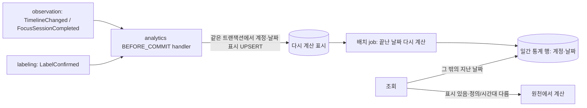

# 활동 분석(설계 단계)

활동 분석은 관찰 타임라인(사실)·확정 라벨(사용자가 정한 의미)·집중 세션(사용자가 의도한 작업)을 합쳐, 하루 동안 어디에 시간을 썼고 얼마나 자주 오갔으며 집중 세션에서 무엇이 이탈을 만들었는지 보여 주는 기능이다. 세 원천의 권위는 바꾸지 않고, AI 추정이나 미관찰 시간의 추정은 결과에 넣지 않는다.

**현재 상태**: 요구사항·지표 명세는 `status: draft`, 설계 ADR 0016은 `status: proposed`다. 코드에는 `analytics` BC 골격, `consistent_snapshot` 트랜잭션 헬퍼, 시험용 참조 구현과 상태 모델 도구만 있다. 공개 API·테이블·handler는 아직 없다. 원본 문서와 이 페이지가 다르면 원본이 맞다.

## 분석 데이터 C1~C7

원본: [docs/requirements/activity-analytics.md](../../docs/requirements/activity-analytics.md) 「현재 구현 범위」

| ID | 분석 데이터 | 단위 |
| --- | --- | --- |
| C1 | 앱 사용 시간 순위와 사용 대상(앱·사이트) 사용 시간 순위 | 계정 시간대의 날짜 |
| C2 | 날짜별 사용 대상 전환 횟수와 목록 | 계정 시간대의 날짜 |
| C3 | 세션별 사용 대상 전환 횟수와 목록 | 완료된 집중 세션 |
| C4 | 세션 분석 시간의 집중·이탈·확정 미분류·판정 대기·불투명·미관찰 구성 | 완료된 집중 세션 |
| C5 | 방해 앱별 진입 횟수·이탈 시간 | 완료된 집중 세션 |
| C6 | 집중 이탈별 이탈 근거 | 집중 이탈 |
| C7 | 라벨 전환 횟수와 목록 | 날짜, 완료된 집중 세션 |

집중 세션 완료 때 선택적으로 보내는 **일시중지 구간**은 저장하고 분석에서 뺀다. 진행 중 세션(`ended_at` 없음)은 분석하지 않는다. 용어 정의는 [docs/ubiquitous-language.md](../../docs/ubiquitous-language.md) 「활동 분석」을 본다.

## 생성 흐름(제안 ADR 0016)

원본: [ADR 0016](../../docs/adr/0016-compute-activity-analytics-on-read-and-store-daily-stats.md). 앞선 초안(15분 UTC 칸과 세션 단위 저장)은 칸 경계에서 0초 구간을 잃고 증명할 부품이 많아, 하루 활성 사용자 1천 명 목표로 다시 설계했다. 가장 바쁜 실제 하루의 C1~C7 계산은 Python 프로토타입으로 중앙값 20ms, 최대 69ms였다(DB 읽기 제외).

- **조회 때 계산**: 세션 분석(C3~C6, 세션별 C7)과 오늘의 일간 통계는 저장하지 않고 조회 때 원천에서 계산한다.
- **지난 날짜 저장**: (계정, 계정 시간대 날짜)마다 C1·C2·C7, 그날 **시작한** 완료 세션의 합, 보조 값 5개와 `source_version`·`definition_version`·`timezone`·`computed_at`을 저장한다. 값은 여러 날을 더해 주간·월간·연간 통계를 만들 수 있는 형태다.
- **하루 읽기 집합**: `started_at < 날짜 끝`이고 `COALESCE(ended_at, last_observed_at) >= 날짜 시작`인 구간을 읽고, 같은 사용 대상으로 맞닿은 앞 구간을 날짜 밖까지 거슬러 읽는다. `>`로 읽으면 자정의 0초 구간을, 거슬러 읽지 않으면 자정을 넘는 체류를 잃는다.
- **변경 표시**: observation·labeling은 이벤트만 남기고, analytics의 BEFORE_COMMIT handler가 같은 트랜잭션에서 영향받는 (계정, 날짜) 표시를 UPSERT한다. 표시 날짜를 정하는 계정 시간대는 계정 advisory 잠금 뒤에 읽는다. 계정 시간대를 바꾸면 저장 행·표시가 있는 날짜와 그 앞뒤 하루에 표시를 더한다.
- **정확성은 조회가 보장**: 표시가 남았거나 `definition_version`·`timezone`이 현재와 다른 날짜는 저장 행 대신 조회 때 계산한다. 배치가 실패하거나 늦어도 결과는 원천의 현재 상태를 반영하고, 조회가 느려질 뿐이다. 여러 조회를 한 스냅샷으로 읽도록 분석 조회는 REPEATABLE READ 스냅샷(`consistent_snapshot`)을 쓴다.
- **배치**: [ADR 0010](../../docs/adr/0010-run-batch-jobs-in-apscheduler-process.md)의 job으로 끝난 날짜의 표시와 옛 정의 행을 처리한다. 저장은 `source_version`이 클 때만 교체하고, 표시는 선점 때 읽은 version과 같을 때만 지운다.
- **90일 지난 날짜**: 원천을 S3로 옮기고 동결 시각 `frozen_before` 이전 범위의 원천 변경을 거부한다. S3 원천 날짜는 조회가 계산하지 않고 저장 값을 쓰며, 정의·시간대가 바뀌어 다시 계산이 끝나지 않았으면 "이전 기준"과 함께 돌려준다.

공개 경로·응답 형태와 테이블 구조는 엔지니어링 계획에서 정한다.

## 근거 문서

| 문서 | 역할 |
| --- | --- |
| [요구사항](../../docs/requirements/activity-analytics.md) | 기능 요구(FR), 정책·불변식, 분석 화면 원칙, 인수 조건(AC), 날짜별 사용자 결정 |
| [지표 명세](../../docs/activity-analytics-metrics.md) | C1~C7의 정의·단위·포함·제외, 경계 사례(`B`)와 반례(`X`), 실제 기록 측정, 세션 합·보조 값 정의 |
| [골든 데이터셋](../../docs/activity-analytics-golden.md) | 사람이 만든 외부 정답(일지·통제 구간 시나리오·OS 로거 기계 정답)과 허용 오차, 비교 도구 |
| [검증 계획](../../docs/activity-analytics-verification.md) | 테스트마다 대상·입력·판정·계층과 대응 AC·불변식, 지금 있는 것과 7단계에 만들 것 |
| [위험](../../docs/activity-analytics-risks.md) | 지표 왜곡·타당성·개인정보·정의 변경 위험과 측정 한계(계정 1개·6일, 확정 라벨·세션 0건) |

## 시험용 코드와 도구

- **독립 참조 구현** [tests/support/analytics_reference/](../../tests/support/analytics_reference/__init__.py): 명세를 검증하는 정답 계산기다. 근거는 지표 명세·요구사항·용어집뿐이고 표준 라이브러리만 쓴다. 공개 함수는 `read_day`, `daily`, `session`이다. 사이트 키는 IDNA 2003으로 바꾼 ASCII 소문자 호스트에서 끝 점을 지운 값이다. 제품 구현의 차등 비교 상대가 된다. 검증은 `uv run pytest tests/unit/support/analytics_reference`다.
- **프로토콜 상태 모델** [tools/analytics_protocol_models/](../../tools/analytics_protocol_models/README.md): ADR 0016 일간 통계 프로토콜(표시·배치·저장 guard·조회 스냅샷·재시도·시간대 변경·90일 보관·세션 표시)을 원자 단계 단위로 BFS 전수 탐색해 불변식을 검사한다. 모듈마다 추천 변형과 대조 변형의 기대 결과를 `EXPECTED`에 두고, 다르면 종료 코드 1이다. 실행은 `uv run --locked python -m tools.analytics_protocol_models.<모듈> [--small]`이다. 전체 탐색은 수 분~10분이라 프로토콜을 바꿀 때 수동으로 돌리고, CI는 `tests/unit/tools/test_analytics_protocol_models.py`로 `--small`만 돌린다(`session_marks`는 전체).
- **임시 원본** [tools/analytics_originals/](../../tools/analytics_originals/README.md): 4~6단계 설계 검증에 쓴 속성 테스트 생성기 원본을 Ruff·ty 검사를 피하려 `.py.txt`로 둔다. 7단계 하위 Issue가 Hypothesis 전략으로 옮긴 뒤 지운다.

## 관련 페이지

- [제품 기능과 도메인 용어](product-overview.md)
- [유효한 결정](../decisions/active-decisions.md)
- [현재 구조](../architecture/current-structure.md)
- [테스트와 검증](../development/testing-and-verification.md)
